<div>

# 🛡️ Footprinting & Network Scanning
### Networkwalks Cybersecurity Internship · Week 2 · Project Work


</div>

---

## 📋 Report Details

| Field | Detail |
|---|---|
| **Intern Name** | KARTHIKEYA SHAILESH KUMAR |
| **Program / Batch** | B084 – Networkwalks Cybersecurity Internship |
| **Task Code** | WK2 – Week 2 Project Work |
| **Test Date** | 10 November 2026 |
| **Modules Completed** | W2-PM1, W2-PM3, W2-PM4, W2-PM5 (Essential) + Final Report |
| **Attacker Machine** | Kali Linux 2026.3 (VirtualBox VM) |
| **Scanning Host** | Windows 11 PC (Zenmap / Nmap 7.993) |
| **Primary Target** | `networkwalks.com` (client's own public website) |
| **Local Scan Scope** | Own home LAN – `192.168.0.0/24` |

---

## 📑 Table of Contents

1. [Overview](#-overview)
2. [Objectives](#-objectives)
3. [Modules Completed](#-modules-completed)
4. [Authorization & Scope](#-authorization--scope)
5. [Tools Used](#-tools-used)
6. [W2-PM1 – Footprinting with Multiple Kali Tools](#-w2-pm1--footprinting-with-multiple-kali-tools)
7. [W2-PM3 – Maltego Footprinting](#-w2-pm3--maltego-footprinting)
8. [W2-PM4 – theHarvester Footprinting](#-w2-pm4--theharvester-footprinting)
9. [W2-PM5 – Zenmap Network Scanning](#-w2-pm5--zenmap-network-scanning)
10. [Consolidated Findings](#-consolidated-findings)
11. [Learnings](#-challenges--learnings)
12. [Final Report](#-final-report-w2-pm-final)
13. [Repository Structure](#-repository-structure)
14. [Disclaimer](#-liability-disclaimer)

---

## 🔎 Overview

This repository documents my **Week 2** work in the Networkwalks Cybersecurity Internship. Week 2 covers the first two phases of a penetration test:

- **Phase 1 – Footprinting & Reconnaissance:** collecting information about a target (domain registration, DNS records, technologies, WAF, e-mail addresses) using passive and light information-gathering tools.
- **Phase 2 – Network Scanning:** discovering live hosts on a network and mapping them.

All reconnaissance was performed from the Kali Linux lab built in Week 1, and the network scan was run with Zenmap from my own Windows machine against my own local subnet.

---

## 🎯 Objectives

- Perform footprinting on `networkwalks.com` using six Kali Linux tools.
- Use **Maltego** to build a graph of relationships around a target domain.
- Use **theHarvester** to collect open-source intelligence (OSINT) for a domain.
- Use **Zenmap** to discover live hosts on my own LAN and view the network topology.
- Document every step with evidence (screenshots) and summarise the findings in a professional report.

---

## ✅ Modules Completed

| Module | Type | Topic | Status |
|---|---|---|---|
| **W2-PM1** | Elective | Footprinting with multiple Kali tools (6 tools on networkwalks.com) | ✅ Completed |
| **W2-PM3** | Elective | Maltego-based footprinting | ✅ Completed |
| **W2-PM4** | Elective | theHarvester-based footprinting | ✅ Completed |
| **W2-PM5** | **Essential** | Zenmap-based network scanning | ✅ Completed |
| **W2-PM-FINAL** | **Essential** | Detailed penetration-testing report | 📄 See [report link](#-final-report-w2-pm-final) |

> The programme requires at least **one elective + both essential modules**. Three electives were completed, exceeding the minimum.

---

## 📝 Authorization & Scope

Testing followed the Networkwalks *Letter of Authorization for Cybersecurity Testing*.

| Item | Detail |
|---|---|
| **In-scope targets** | `networkwalks.com` and its public DNS records; the tester's own local area network |
| **Authorized activities** | Passive/light footprinting (whois, whatweb, nslookup, curl, wafw00f, dnsrecon); network scanning and host discovery of own subnet (Zenmap / Nmap ping scan) |
| **Prohibited activities** | Exploitation, privilege escalation, denial of service, brute force, password attacks, data access/modification, social engineering |

**What I did:** only information gathering and a ping-scan host discovery. No exploitation, brute-forcing or intrusive scanning was performed. theHarvester was run in passive OSINT mode (public search sources) against a public domain.

---

## 🧰 Tools Used

| Tool | Purpose | Module |
|---|---|---|
| `whois` | Domain registration information | PM1 |
| `whatweb` | Website technology fingerprinting | PM1 |
| `nslookup` | DNS A-record lookup | PM1 |
| `curl -I` | HTTP response header inspection | PM1 |
| `wafw00f` | Web Application Firewall detection | PM1 |
| `dnsrecon` | DNS enumeration (SOA, NS, MX, A, TXT, SRV) | PM1 |
| **Maltego** 4.14.0 | Graph-based link analysis / OSINT | PM3 |
| **theHarvester** 4.11.1 | E-mail, host and IP OSINT collection | PM4 |
| `ipconfig` | Identify local IP and subnet on Windows | PM5 |
| **Zenmap / Nmap 7.993** | Host discovery (ping scan) and topology | PM5 |

---

## 🧪 W2-PM1 – Footprinting with Multiple Kali Tools

**Target:** `networkwalks.com` · **Machine:** Kali Linux · **Date:** 10 Nov 2026

### Task 1 – `whois` (domain registration)

```bash
whois networkwalks.com
```

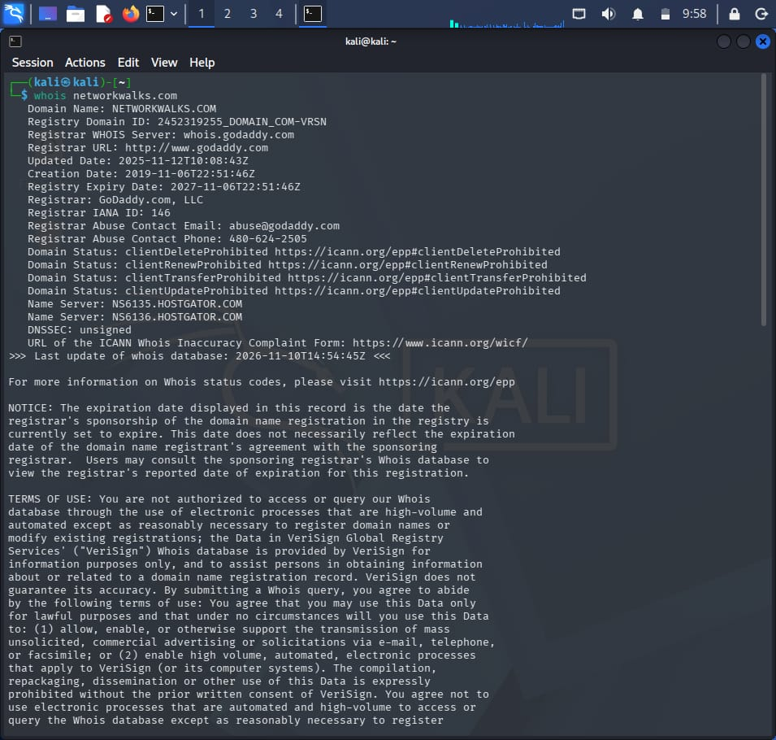

| Attribute | Value |
|---|---|
| Registrar | GoDaddy.com, LLC (IANA ID 146) |
| Creation date | 2019-11-06 |
| Last updated | 2025-11-12 |
| Registry expiry | 2027-11-06 |
| Name servers | `NS6135.HOSTGATOR.COM`, `NS6136.HOSTGATOR.COM` |
| DNSSEC | **unsigned** |
| Domain status | `clientDeleteProhibited`, `clientRenewProhibited`, `clientTransferProhibited`, `clientUpdateProhibited` |
| Registrar abuse contact | abuse@godaddy.com |

**Observation:** the domain is registered with GoDaddy and hosted on HostGator name servers. The four `client*Prohibited` locks protect the domain against accidental or unauthorized transfer/deletion. DNSSEC is not enabled.

---

### Task 2 – `whatweb` (technology fingerprinting)

```bash
whatweb networkwalks.com
```

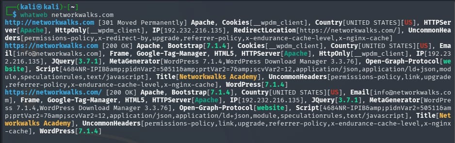

| Attribute | Value |
|---|---|
| Redirect | `http://` → `https://` (301 Moved Permanently) |
| Web server | Apache |
| CMS | WordPress 7.1.4 (exposed via MetaGenerator tag) |
| Plugin | WordPress Download Manager 3.3.76 |
| Front-end | HTML5, Bootstrap, jQuery 3.7.1 |
| Analytics | Google Tag Manager |
| IP address | 192.232.216.135 |
| Country | United States |
| Contact e-mail | info@networkwalks.com |
| Cookie | `__wpdm_client` (HttpOnly) |

**Observation:** the site is a WordPress site on Apache, and the CMS and plugin versions are disclosed in the page source, which helps an attacker identify known vulnerabilities.

---

### Task 3 – `nslookup` (DNS resolution)

```bash
nslookup networkwalks.com
```

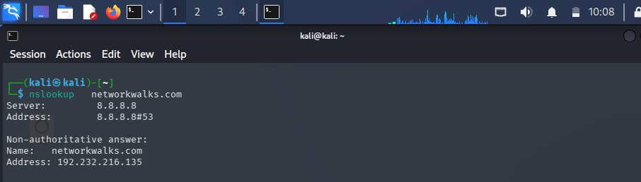

| Attribute | Value |
|---|---|
| DNS server used | 8.8.8.8 (Google Public DNS) |
| Answer type | Non-authoritative |
| Resolved IPv4 | **192.232.216.135** |

**Observation:** the resolved IP matches the IP found by `whatweb`, confirming the web server's address.

---

### Task 4 – `curl -I` (HTTP headers)

```bash
curl -I https://networkwalks.com
```

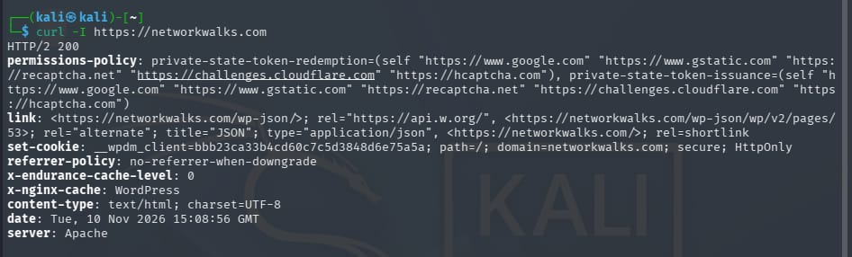

| Header | Value / Meaning |
|---|---|
| Status | `HTTP/2 200` – site reachable over HTTPS |
| `server` | Apache |
| `content-type` | `text/html; charset=UTF-8` |
| `link` | Exposes the WordPress REST API (`/wp-json/`) |
| `set-cookie` | `__wpdm_client` with `secure; HttpOnly` flags |
| `referrer-policy` | `no-referrer-when-downgrade` |
| `permissions-policy` | Private-state-token rules for Google, reCAPTCHA, Cloudflare, hCaptcha |
| `x-nginx-cache` / `x-endurance-cache-level` | Server-side caching in use |
| `date` | Tue, 10 Nov 2026 15:08:56 GMT |

**Observation:** the cookie is set with `Secure` and `HttpOnly`, which is good practice. The headers also reveal the technology stack (Apache, WordPress REST API, caching layers).

---

### Task 5 – `wafw00f` (WAF detection)

```bash
wafw00f https://networkwalks.com
```

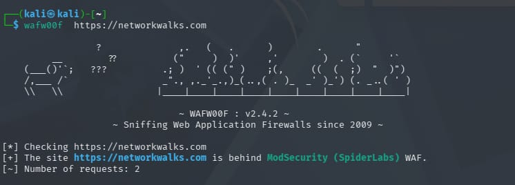

| Attribute | Value |
|---|---|
| Tool version | WAFW00F v2.4.2 |
| Result | Site is behind **ModSecurity (SpiderLabs)** WAF |
| Requests sent | 2 |

**Observation:** a Web Application Firewall protects the site. Knowing this matters because a WAF can block or alter later testing traffic.

---

### Task 6 – `dnsrecon` (DNS enumeration)

```bash
dnsrecon -d networkwalks.com
```

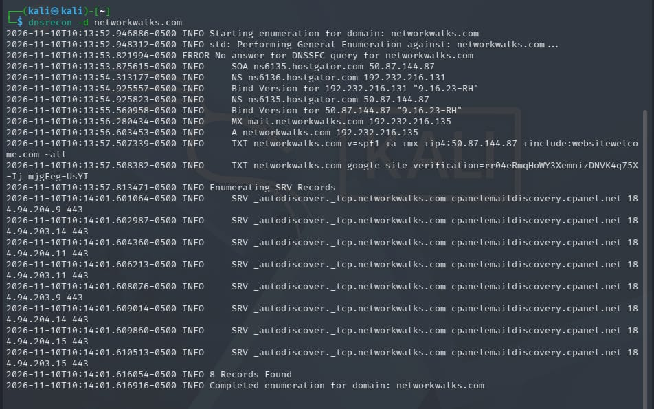

| Record | Value |
|---|---|
| **SOA** | `ns6135.hostgator.com` – 50.87.144.87 |
| **NS** | `ns6136.hostgator.com` – 192.232.216.131 |
| **NS** | `ns6135.hostgator.com` – 50.87.144.87 |
| **MX** | `mail.networkwalks.com` – 192.232.216.135 |
| **A** | `networkwalks.com` – 192.232.216.135 |
| **TXT (SPF)** | `v=spf1 +a +mx +ip4:50.87.144.87 +include:websitewelcome.com ~all` |
| **TXT** | Google site-verification record |
| **SRV** | `_autodiscover._tcp` → `cpanelemaildiscovery.cpanel.net:443` (8 entries) |
| **DNSSEC** | No answer – not signed |
| **Total** | 8 records found |

**Observation:**
- The name servers respond with their **BIND version (9.16.23-RH)** – version information leakage.
- The SPF record ends with `~all` (soft-fail) instead of `-all` (hard-fail), so spoofed mail is only marked, not rejected.
- The domain uses cPanel mail auto-discovery, consistent with HostGator shared hosting.

---

## 🕸️ W2-PM3 – Maltego Footprinting

**Tool:** Maltego Graph (Desktop) 4.14.0 · **Seed entity:** `networkwalks.com` (Domain)

### Step 1 – Launch Maltego and open a new graph

Installed Maltego on my Windows machine, signed in, and opened a blank graph with the Entity Palette on the left.

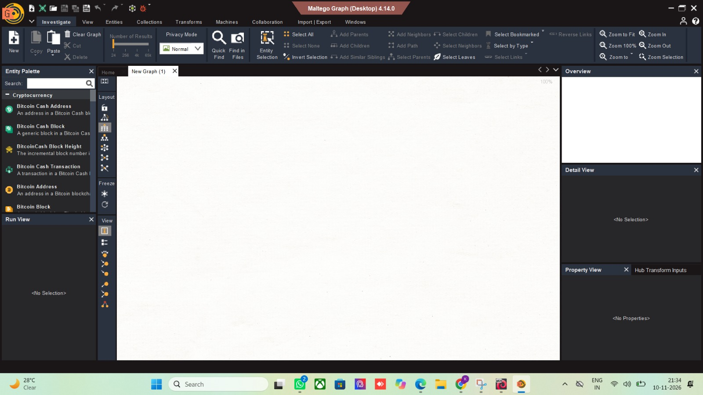

### Step 2 – Add the domain and run a transform

Dragged a **Domain** entity from the palette, set it to `networkwalks.com`, and ran the transform **To Emails @domain [Search Engine]** (Utilities).

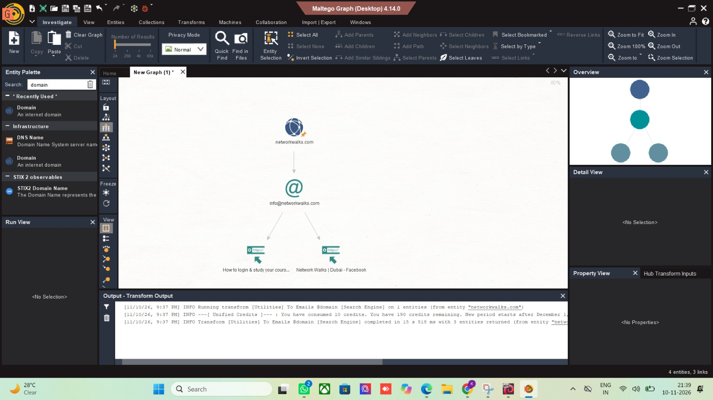

| Result | Detail |
|---|---|
| Transform run | `[Utilities] To Emails @domain [Search Engine]` |
| Entities returned | 3 (graph total: 4 entities, 3 links) |
| E-mail found | **info@networkwalks.com** |
| Web pages linked to the e-mail | "How to login & study your cours…" and "Network Walks \| Dubai – Facebook" |
| Transform time | ~15 s |

**Observation:** Maltego linked the domain to its public contact e-mail and to two public web pages that mention it. The graph shows how one piece of data (the e-mail) connects to other online resources, which is the basis of link analysis. The e-mail address could be used in phishing or social-engineering scenarios, so public contact addresses should be monitored.

---

## 🌾 W2-PM4 – theHarvester Footprinting

**Tool:** theHarvester 4.11.1 (Kali Linux) · **Mode:** passive OSINT · **Domain used:** `microsoft.com`

### Step 1 – View the help menu and available options

```bash
theHarvester -h
```

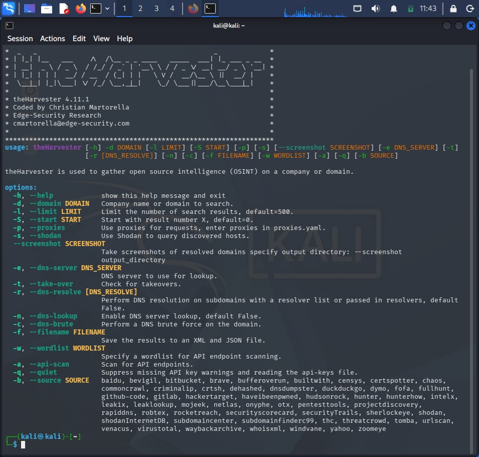

Key options used or reviewed: `-d` (domain), `-l` (result limit), `-b` (data source), `-f` (save to file), `-c` (DNS brute-force), `-s` (Shodan). Sources include baidu, crtsh, dnsdumpster, duckduckgo, hackertarget, otx, rapiddns, threatcrowd, urlscan, virustotal, waybackarchive, yahoo and many more.

### Step 2 – Query all sources

```bash
theHarvester -d microsoft.com -l 50 -b all
```

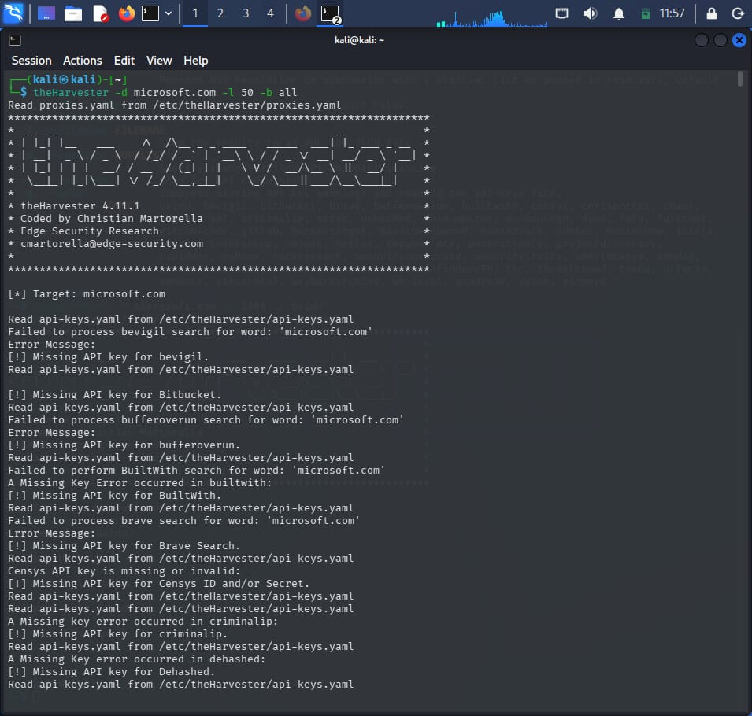

**Observation:** the tool tried every supported source. Many sources (bevigil, Bitbucket, bufferoverun, BuiltWith, Brave, Censys, criminalip, Dehashed, …) returned `Missing API key` errors because their API keys are not configured in `/etc/theHarvester/api-keys.yaml`. Sources that need no key still work.

### Step 3 – Query a single source (Baidu)

```bash
theHarvester -d microsoft.com -l 1000 -b baidu
```

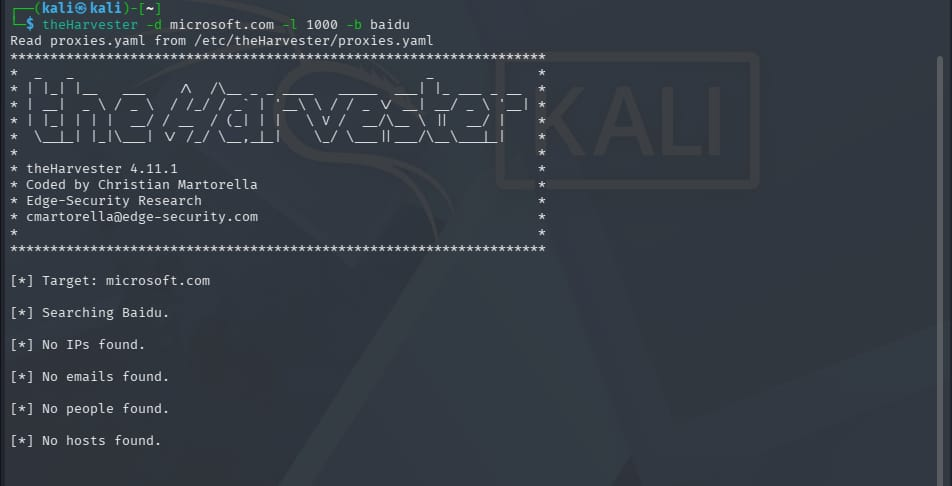

**Observation:** Baidu returned **no IPs, e-mails, people or hosts**. Search-engine sources often return nothing because of bot protection or rate-limiting, so results should be cross-checked with other sources.

---

## 📡 W2-PM5 – Zenmap Network Scanning *(Essential)*

**Tool:** Zenmap (Nmap 7.993) on Windows 11 · **Scan scope:** own LAN only

### Step 1 – Identify my local IP address and subnet

```cmd
ipconfig
```

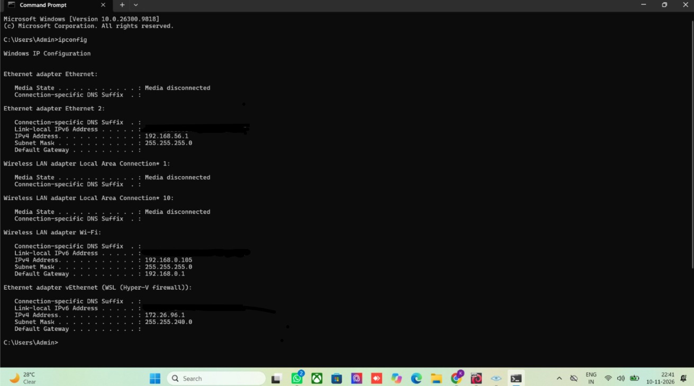

| Adapter | IPv4 address | Subnet mask | Gateway |
|---|---|---|---|
| **Wi-Fi** (main LAN) | **192.168.0.105** | 255.255.255.0 (/24) | 192.168.0.1 |
| Ethernet 2 (VirtualBox host-only) | 192.168.56.1 | 255.255.255.0 | – |
| vEthernet (WSL / Hyper-V) | 172.26.96.1 | 255.255.240.0 | – |

My LAN subnet is therefore **192.168.0.0/24**.

### Step 2 – Run a ping scan (host discovery)

```text
Target : 192.168.0.0/24
Profile: Ping scan
Command: nmap -sn 192.168.0.0/24
```

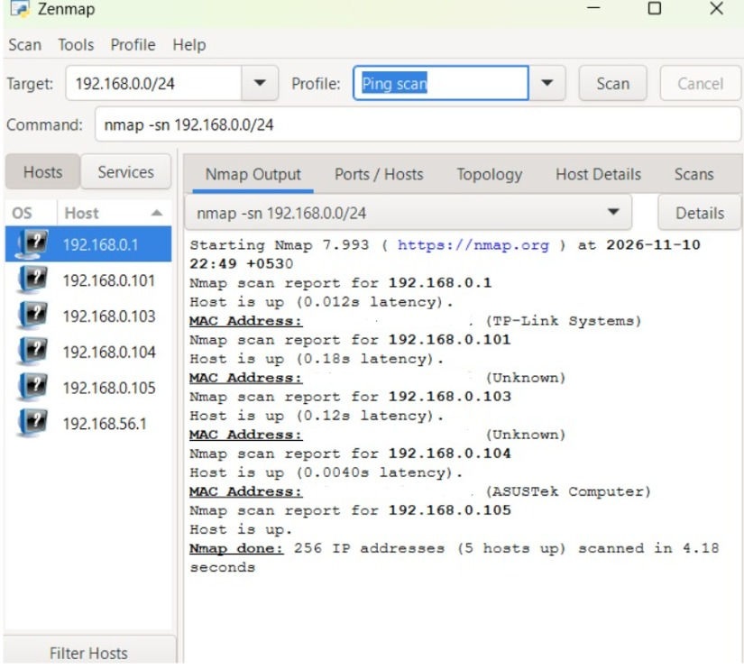

| Result | Value |
|---|---|
| Scan date | 2026-11-10, 22:49 (+05:30) |
| Addresses scanned | 256 |
| **Live hosts** | **5** |
| Scan time | 4.18 seconds |

| Host | Latency | Vendor (from MAC) | Likely role |
|---|---|---|---|
| 192.168.0.1 | 0.012 s | TP-Link Systems | Router / default gateway |
| 192.168.0.101 | 0.18 s | Unknown | Other LAN device |
| 192.168.0.103 | 0.12 s | Unknown | Other LAN device |
| 192.168.0.104 | 0.0040 s | ASUSTek Computer | Other LAN device (ASUS) |
| 192.168.0.105 | – | – | **My own PC** (scanner) |

> MAC addresses are hidden in the screenshots for privacy.

### Step 3 – View the network topology

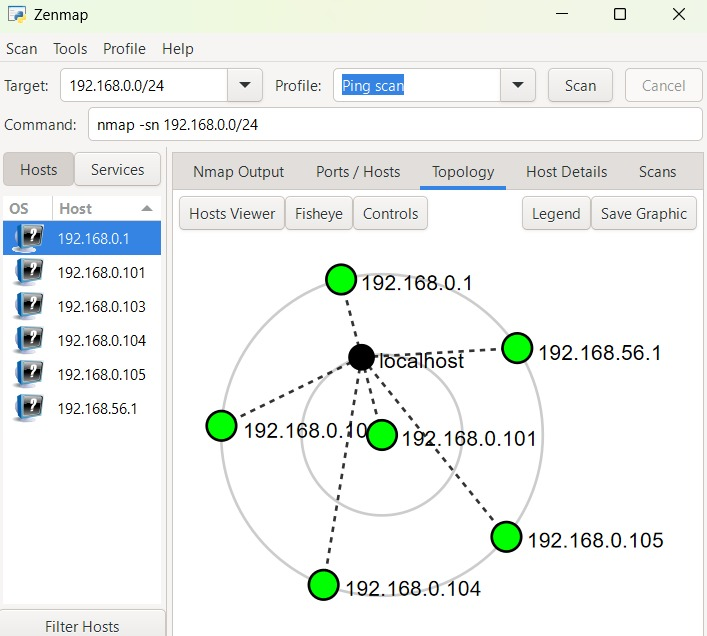

The **Topology** tab shows `localhost` at the centre with each discovered host connected to it: 192.168.0.1, .101, .103, .104, .105 and the host-only adapter 192.168.56.1.

**Observation:** a ping scan quickly shows which devices are present on the network without probing their ports. Any unknown device in the list (such as `.101` and `.103`) should be identified and verified, because unrecognised devices can indicate unauthorized access to the Wi-Fi network.

---

## 🔐 Consolidated Findings

| # | Finding | Source | Risk | Note |
|---|---|---|---|---|
| 1 | WordPress and plugin versions exposed (WordPress 7.1.4, WP Download Manager 3.3.76) | whatweb | Low–Medium | Helps attackers match known vulnerabilities |
| 2 | DNS servers disclose BIND version 9.16.23-RH | dnsrecon | Low | Information leakage |
| 3 | DNSSEC not enabled | whois, dnsrecon | Low | DNS responses are not cryptographically signed |
| 4 | SPF uses soft-fail (`~all`) | dnsrecon | Low | Spoofed e-mail may still be delivered |
| 5 | Public contact e-mail discoverable | whatweb, Maltego | Informational | Can be used for phishing/social engineering |
| 6 | WordPress REST API advertised in headers | curl | Informational | Normal for WordPress, but should be hardened |
| 7 | WAF present (ModSecurity) | wafw00f | Positive | Good defensive control |
| 8 | Domain registrar locks enabled; HTTPS redirect and Secure/HttpOnly cookie in use | whois, whatweb, curl | Positive | Good security practice |
| 9 | Unknown devices on the LAN (192.168.0.101, .103) | Zenmap | Informational | Should be verified by the network owner |

---

## 📚 Learnings

- Footprinting is mostly **passive** and builds a picture of the target before any scanning.
- Different tools expose different layers: registration (whois), DNS (nslookup, dnsrecon), web stack (whatweb, curl), defences (wafw00f), and relationships (Maltego, theHarvester).
- Always work **within written authorization and scope**.
- Network scanning starts with host discovery; ping scans are quick and low-impact.
- Good documentation with evidence is as important as the technical work.

---

## 📄 Final Report (W2-PM-FINAL)

The detailed penetration-testing report covering the modules above is available here:

> 🔗 **Report link:** `ADD-YOUR-REPORT-LINK-HERE`

---

## 📁 Repository Structure

```text
NETWORKWALKS--KARTHIKEYA-B084-WK2-FOOTPRINTING-AND-NETWORK-SCANNING/
├── README.md
└── screenshots/
    ├── PM1-1-whois.png
    ├── PM1-2-whatweb.png
    ├── PM1-3-nslookup.png
    ├── PM1-4-curl.png
    ├── PM1-5-wafw00f.png
    ├── PM1-6-dnsrecon.png
    ├── PM3-1-maltego-launch.png
    ├── PM3-2-maltego-graph.png
    ├── PM4-1-theharvester-help.png
    ├── PM4-2-theharvester-all-sources.png
    ├── PM4-3-theharvester-baidu.png
    ├── PM5-1-ipconfig.png
    ├── PM5-2-zenmap-ping-scan.png
    └── PM5-3-zenmap-topology.png
```

---

## ⚠️ Liability Disclaimer

This work was carried out **for educational purposes only** as part of the Networkwalks Cybersecurity Internship. Reconnaissance of `networkwalks.com` and scanning of my own local network were performed under the permitted scope. The techniques shown must not be used against any system without explicit written permission. I accept no responsibility for misuse of the information in this repository.

---

<div>

**Prepared by KARTHIKEYA SHAILESH KUMAR · Batch B084 · Networkwalks Cybersecurity Internship**

[networkwalks.com](https://networkwalks.com)

</div>
